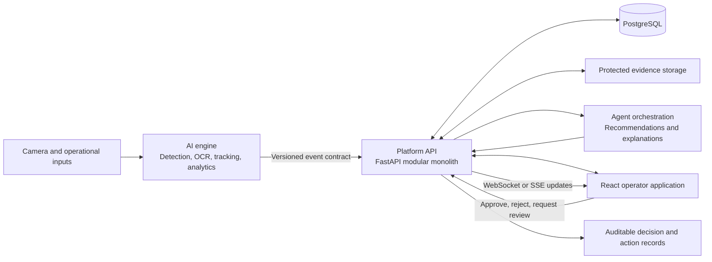

# Vanguard AI Architecture

## Implementation status

The repository currently implements the FastAPI application and `GET /health`, Pydantic Settings configuration, SQLAlchemy declarative `Base`, SQLAlchemy engine/session management, and a successful local PostgreSQL connection check. `backend/tests/test_database.py` contains three database-related test functions. There are no operational SQLAlchemy models, Alembic migrations, or application tables yet. The only implemented API route is `/health`.

Evidence workflows, event ingestion, business APIs, authentication/authorization, agent execution, approval APIs, dashboards, and computer-vision pipelines described below are target architecture, not completed features.

## Overview

Vanguard AI is an industrial operations platform for logistics and warehouse workflows. It combines a web application, a modular FastAPI platform, computer-vision and analytics capabilities, and task-focused agents. The initial system is a **modular monolith**: one deployable platform API with explicit internal boundaries. Separate services are deferred until scale or operational needs justify them.

The planned workflows are inventory intelligence, parcel and dispatch intelligence, loading dock intelligence, package damage intelligence, and warehouse safety intelligence. The target system will record observations and recommendations with evidence and provenance. Business actions with operational consequences must require appropriate human approval.

## System components

- **Frontend (`frontend/`, planned)**: React and TypeScript operator interface for dashboards, events, evidence, recommendations, and approvals. It will call versioned platform APIs and must not connect directly to the database or model runtime.
- **Platform API (`backend/app/`)**: the FastAPI application and health endpoint exist. Authentication and authorization boundaries, business APIs, domain workflows, audit records, approvals, and integration adapters remain planned.
- **AI engine (`ai_engine/`, planned)**: computer vision, OCR/barcodes, tracking, classification, event processing, prediction, and explainability. Model code and inference dependencies stay outside the platform backend.
- **Agents (`agents/`, planned)**: orchestration and bounded workflow agents that will interpret validated operational events and produce recommendations. Agent tools must enforce permissions and approval requirements.
- **PostgreSQL**: the local connection foundation is configured and verified. Operational tables for events, workflow state, user decisions, and audit history are proposed, not created; see [Database design](DATABASE_DESIGN.md).
- **Evidence storage (planned)**: images and other bulky evidence should live in access-controlled object/file storage. Future API and event records should carry opaque references, not public URLs or image bytes.

## Frontend architecture

When implemented, organize the application by operator-facing domain (events, inventory, dispatch, docks, damage, safety, approvals, analytics) and keep shared API clients, authentication, layout, and reusable UI components separate. TypeScript types for API payloads should be generated from or kept aligned with versioned API schemas. TanStack Query should own remote server state; React Router should own navigation. Recharts is for operational summaries, not a substitute for accessible tabular event details. Tailwind CSS supports shared design tokens and responsive layouts.

The frontend presents simulated data distinctly from live operational data. It cannot authorize actions by hiding controls; the backend must enforce permissions and approval state.

## Backend architecture

Keep HTTP routing thin and group future business endpoints under `/api/v1`. Route handlers should validate inputs and delegate to services. Suggested boundaries are `api/routes` and `api/dependencies`, `core` for settings/security primitives, `schemas` for request/response contracts, `models` for persistence mappings, `database` for sessions and migrations, `services` for business workflows, and `integrations` for AI and external adapters. The currently implemented health route remains available at `/health`; business routes are not yet implemented.

Use Pydantic at API/integration boundaries and the existing SQLAlchemy 2.x foundation for future persistence. Alembic should own schema evolution once configured; no migrations or operational models currently exist. Services should be testable without a live model runtime; integration adapters can be replaced by fakes in tests. Do not duplicate AI model implementation in the backend.

## Database architecture

PostgreSQL is the intended system of record for users/roles, facilities and cameras, operational events, workflow/approval state, and audit records. A local database connection has been verified; the proposed operational schema has not been created. Define normalized entities, foreign keys, indexes, retention, and tenant/facility access boundaries before creating migrations. Persist event schema version and source provenance. Store evidence references separately from evidence bytes. Avoid embedding credentials in connection strings committed to source control.

No operational database schema, tables, or migrations are currently implemented. The connection setup is a foundation only.

## AI engine integration

The planned AI engine owns model loading, preprocessing, inference, tracking, OCR/barcode extraction, model confidence, and model-specific explainability. It should emit validated, versioned events through a documented adapter boundary. The platform API is intended to own authorization, durable event intake, operational workflow, audit history, and approval; these features are not yet implemented. The proposed payload contract is defined in [API_CONTRACTS.md](API_CONTRACTS.md).

Model results are evidence for an operational decision, not authorization to perform one. Include model/algorithm identifiers and relevant confidence or evidence metadata when available. Preserve uncertainty and surface it to operators; do not represent a confidence score as certainty.

## Agent orchestration

The planned orchestrator will route eligible events to bounded domain agents (inventory, dispatch, dock, damage, safety) and a decision engine. LangGraph is a possible future orchestration option and is not an implemented dependency. Agents should receive only the scoped event and tools needed for their task, return structured recommendations with rationale and supporting references, and never bypass platform authorization. The platform is intended to record agent/version provenance and route consequential actions through approval.

## Event processing

The proposed flow is: a producer creates an event with a unique ID and schema version; a future API authenticates the producer, validates the payload, checks idempotency, and persists the event; processing assigns it to relevant workflows/agents; recommendation and evidence references are stored; the UI receives a status update; an authorized user reviews when needed; the API records the decision and any separately authorized action. This flow is not implemented. Retries must be idempotent. Invalid payloads should receive structured errors and must not be silently accepted. Queue technology is deferred until throughput and delivery requirements are known.

## Human approval and audit

Recommendations and consequential actions must be separate states. When approval APIs are implemented, records should identify the actor, decision, time, target action, and rationale where supplied. The server must check role, scope, current state, and approval policy at execution time. A rejection or expired approval cannot be replayed as authorization. Audit records should be append-only at the application boundary and capture event, recommendation, human decision, and action provenance. Approval policy is domain-specific and should fail closed when required review cannot be established. These workflows are planned and not currently implemented.

## Security boundaries

- Authenticate service producers and human users; authorize every request server-side by role and facility/resource scope.
- Keep secrets in local environment or a secrets manager; `.env` files and real credentials are not source artifacts.
- Use TLS in deployed environments, validate uploads and payload sizes, and avoid exposing evidence through guessable/public links.
- Treat camera observations, OCR text, and agent/model output as untrusted input. Do not execute instructions found in operational data.
- Minimize employee data. Facial recognition and emotion inference for employee monitoring are out of scope.
- Separate simulated/sample data from real operational records, and document retention/access controls before ingesting real footage.

## Real-time communication

Begin future integrations with ordinary versioned HTTP APIs. Use server-sent events (SSE) for one-way event/status updates where sufficient; choose WebSockets only when bidirectional low-latency interaction is required. Both transports must authenticate and enforce facility scope, support reconnect/resync, and carry references/status rather than raw sensitive evidence. No business API, SSE endpoint, or WebSocket endpoint is currently implemented.

## Two-developer responsibilities

| Area | AI & Intelligence Engineer (`dev/ai-engine`) | Platform & Application Engineer (`dev/platform`) |
|---|---|---|
| Owns | `ai_engine/`, `agents/`, model evaluation and inference, event production | `backend/`, `frontend/`, persistence, authentication, approvals, dashboards |
| Defines with partner | Event semantics, confidence/evidence meaning, agent inputs and outputs | API validation, persistence lifecycle, security and approval enforcement |
| Integration | Publishes contract-conforming events; documents model and producer versions | Validates and records events; exposes versioned APIs and operational workflows |
| Shared | `docs/API_CONTRACTS.md`, cross-boundary schemas, integration fixtures, review of contract changes | `docs/API_CONTRACTS.md`, cross-boundary schemas, integration fixtures, review of contract changes |

Use separate work branches and integrate through reviewed pull requests; neither developer commits directly to `main`.
