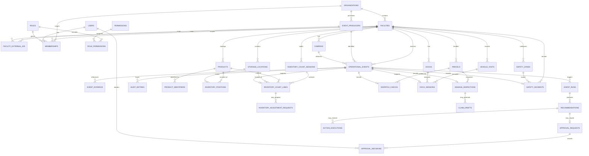

# Vanguard AI Database Design

## Purpose and status

This document proposes a PostgreSQL schema for the Vanguard AI modular monolith. It is a design artifact only: it does not create SQLAlchemy models, migrations, tables, APIs, or database data. The schema keeps the five operational capabilities in one platform while leaving computer-vision inference and model artifacts in `ai_engine/`.

The repository currently has a FastAPI health endpoint, centralized Pydantic Settings and SQLAlchemy engine/session code, and a declarative SQLAlchemy `Base`. `backend/app/models/` has no operational model modules, no Alembic configuration or migrations were found, and no business tables are represented in source. The current health route is independent of the database. Local PostgreSQL connectivity has been verified. `backend/tests/test_database.py` currently contains three test functions.

## Design principles

- Use UUID primary keys for durable records. Generate IDs in application code or with PostgreSQL's built-in `gen_random_uuid()`; do not require a UUID extension.
- Use `TIMESTAMPTZ` for instants and store/compare timestamps in UTC. Keep facility IANA timezone separately for display and local scheduling.
- Use `NUMERIC`, not floating-point, for counts that can be fractional and all financial amounts.
- Keep operational records relational and queryable. Use `JSONB` only for versioned event attributes, model metadata, and genuinely variable details—not as a substitute for stable columns or relationships.
- Store evidence in protected object/file storage. PostgreSQL stores opaque storage keys and metadata, never image/video bytes or public evidence URLs.
- Scope operational records to an organization and facility. Enforce authorization in the platform API on every request; PostgreSQL row-level security can be evaluated later as defense in depth.
- Keep observations, recommendations, human decisions, and action executions distinct. Model/agent output never grants permission by itself.
- Keep audit history append-only at the application boundary, restrict database permissions, and define retention before ingesting real footage or employee-related data.
- Do not store facial identity, face embeddings, or emotion data. Safety records should describe the incident and operational context without identifying a worker unless an independently approved business requirement and privacy review establish otherwise.

## Proposed entity relationship overview

The diagram shows the main relationships; a line represents a foreign-key relationship, and `1:N`/`M:N` labels indicate cardinality. Module-specific detail is below.



## Proposed tables

All tables below are proposed. Unless a table states otherwise, its primary key is `id UUID NOT NULL PRIMARY KEY`; `created_at TIMESTAMPTZ NOT NULL` defaults to the current time. Mutable records should have an `updated_at TIMESTAMPTZ NOT NULL` maintained by the application. Add indexes to foreign keys used for joins and facility-scoped queries. Use named constraints so migrations and error reporting remain understandable.

### Identity, organization, and facility

| Table | Columns, types, keys, and constraints |
|---|---|
| `organizations` | `id UUID PK`; `name TEXT NOT NULL`; `slug TEXT NOT NULL UNIQUE`; `status TEXT NOT NULL CHECK (status IN ('active','suspended'))`; `created_at`, `updated_at`. This creates a clear top-level tenant boundary if Vanguard serves multiple organizations. |
| `facilities` | `id UUID PK`; `organization_id UUID NOT NULL FK -> organizations.id`; `facility_code TEXT NOT NULL`; `name TEXT NOT NULL`; `timezone TEXT NOT NULL` (IANA zone); optional `address_line_1`, `address_line_2`, `city`, `region`, `postal_code`, `country_code CHAR(2)`; `status TEXT NOT NULL CHECK (status IN ('active','inactive'))`; timestamps. `UNIQUE (organization_id, facility_code)` and `UNIQUE (id, organization_id)` support facility-scoped references. |
| `event_producers` | `id UUID PK`; `organization_id UUID NOT NULL FK -> organizations.id`; `producer_key TEXT NOT NULL`; `display_name TEXT NOT NULL`; `status TEXT NOT NULL CHECK (status IN ('active','revoked'))`; optional `credential_reference TEXT` pointing to a secret store (never the credential itself); timestamps; `UNIQUE (organization_id, producer_key)` and `UNIQUE (id, organization_id)`. Resolve `producer_id` from authenticated server-side credentials, not request-body metadata. |
| `facility_external_ids` | `id UUID PK`; `organization_id UUID NOT NULL`; `facility_id UUID NOT NULL`; `producer_id UUID NOT NULL`; `external_warehouse_id TEXT NOT NULL`; `created_at`; composite FK `(facility_id, organization_id) -> facilities(id, organization_id)` and `(producer_id, organization_id) -> event_producers(id, organization_id)`; `UNIQUE (producer_id, external_warehouse_id)`. This maps the producer's `warehouse_id` to an internal `facility_id` within the producer's organization. Reject missing or inactive mappings. |
| `users` | `id UUID PK`; `email TEXT NOT NULL UNIQUE` stored normalized (case-folded); `display_name TEXT NOT NULL`; `is_active BOOLEAN NOT NULL DEFAULT TRUE`; timestamps. Do not store passwords until an authentication design is selected; if local password authentication is later approved, store only a vetted password hash, never the original secret. |
| `roles` | `id UUID PK`; `code TEXT NOT NULL UNIQUE`; `name TEXT NOT NULL`; `scope TEXT NOT NULL CHECK (scope IN ('organization','facility'))`; `description TEXT`; timestamps. Role codes are stable application identifiers; role names are display text. |
| `permissions` | `id UUID PK`; `code TEXT NOT NULL UNIQUE`; `description TEXT NOT NULL`; `created_at`. Permission codes represent server-enforced actions, not UI visibility. |
| `role_permissions` | `role_id UUID NOT NULL FK -> roles.id`; `permission_id UUID NOT NULL FK -> permissions.id`; `created_at`; composite `PRIMARY KEY (role_id, permission_id)`. |
| `memberships` | `id UUID PK`; `organization_id UUID NOT NULL FK -> organizations.id`; `facility_id UUID NULL`; `user_id UUID NOT NULL FK -> users.id`; `role_id UUID NOT NULL FK -> roles.id`; `is_active BOOLEAN NOT NULL DEFAULT TRUE`; `created_at`; optional `ended_at`. Add composite FK `(facility_id, organization_id) -> facilities(id, organization_id)` and a check that `ended_at IS NULL OR ended_at >= created_at`. Use partial unique indexes to prevent duplicate active organization-level and facility-level assignments. Application authorization must verify the role scope and the requested facility. |
| `cameras` | `id UUID PK`; `facility_id UUID NOT NULL FK -> facilities.id`; `camera_code TEXT NOT NULL`; `display_name TEXT NOT NULL`; optional `storage_location_id UUID NULL`; `is_active BOOLEAN NOT NULL DEFAULT TRUE`; timestamps; `UNIQUE (facility_id, camera_code)`. Avoid storing camera credentials or public stream URLs here; use a secret store and opaque connection references. |
| `safety_zones` | `id UUID PK`; `facility_id UUID NOT NULL FK -> facilities.id`; optional `camera_id UUID FK -> cameras.id`; `zone_code TEXT NOT NULL`; `name TEXT NOT NULL`; `zone_type TEXT NOT NULL CHECK (zone_type IN ('restricted','loading','pedestrian','vehicle','other'))`; `geometry JSONB NOT NULL` with documented/versioned coordinate convention; `is_active BOOLEAN NOT NULL DEFAULT TRUE`; timestamps; `UNIQUE (facility_id, zone_code)`. Validate geometry and camera/facility consistency in the service layer. |

`memberships` is the authorization assignment boundary. A single user may hold different roles at different facilities. Do not infer access from an event, recommendation, or client-supplied facility identifier.

### Shared events, evidence, agents, approvals, and audit

| Table | Columns, types, keys, and constraints |
|---|---|
| `operational_events` | `id UUID PK` (internal database identifier); `producer_id UUID NOT NULL FK -> event_producers.id`; `external_event_id UUID NOT NULL` (the contract's `event_id`); `facility_id UUID NOT NULL FK -> facilities.id`, resolved by the server from `(producer_id, warehouse_id)`; optional `camera_id UUID FK -> cameras.id`; `event_type TEXT NOT NULL`; `source TEXT NOT NULL`; `schema_version TEXT NOT NULL`; optional `producer_name`, `producer_version`, `model_version TEXT` (descriptive provenance only); `severity TEXT NOT NULL CHECK (severity IN ('low','medium','high','critical'))`; optional `confidence NUMERIC(5,4) CHECK (confidence BETWEEN 0 AND 1)`; `description TEXT NOT NULL`; `occurred_at TIMESTAMPTZ NOT NULL`; `received_at TIMESTAMPTZ NOT NULL DEFAULT now()`; optional `attributes JSONB NOT NULL DEFAULT '{}'::jsonb`; `payload_fingerprint BYTEA NOT NULL` (SHA-256 of canonical validated payload); `canonicalization_version SMALLINT NOT NULL`; `processing_status TEXT NOT NULL CHECK (processing_status IN ('received','validated','queued','processing','processed','failed','ignored'))`; optional `correlation_id UUID`; `UNIQUE (producer_id, external_event_id)`. Index `(facility_id, occurred_at DESC)`, `(facility_id, event_type, occurred_at DESC)`, and `processing_status`. The stable authenticated producer identity plus external ID forms the idempotency key; body-supplied producer labels do not. |
| `event_evidence` | `id UUID PK`; `event_id UUID NOT NULL FK -> operational_events.id ON DELETE RESTRICT`; `kind TEXT NOT NULL`; `storage_key TEXT NOT NULL` (opaque private reference); `content_type TEXT`; optional `checksum TEXT`, `captured_at TIMESTAMPTZ`, `metadata JSONB NOT NULL DEFAULT '{}'::jsonb`; `created_at`; `retention_class TEXT NOT NULL`; optional `retain_until TIMESTAMPTZ`, `deletion_requested_at TIMESTAMPTZ`, `deleted_at TIMESTAMPTZ`; `status TEXT NOT NULL CHECK (status IN ('available','deletion_pending','deleted'))`. Never store binary media or a publicly accessible URL. Index `event_id`; consider `UNIQUE (event_id, storage_key)`. Retention and deletion are policy decisions that must be approved before production evidence is stored. |
| `agent_runs` | `id UUID PK`; `event_id UUID NOT NULL FK -> operational_events.id ON DELETE RESTRICT`; optional `parent_run_id UUID FK -> agent_runs.id`; `agent_key TEXT NOT NULL`; `agent_version TEXT NOT NULL`; `status TEXT NOT NULL CHECK (status IN ('queued','running','succeeded','failed','cancelled'))`; `started_at`, optional `finished_at TIMESTAMPTZ`; optional safe `error_code TEXT` and bounded `metadata JSONB`; timestamps. Index `(event_id, created_at)` and `(status, created_at)`. Do not store chain-of-thought or secrets. Persist concise, reviewable rationale in recommendations instead. |
| `recommendations` | `id UUID PK`; `agent_run_id UUID NOT NULL FK -> agent_runs.id ON DELETE RESTRICT`; `event_id UUID NOT NULL FK -> operational_events.id ON DELETE RESTRICT`; `action_type TEXT NOT NULL`; `summary TEXT NOT NULL`; `rationale TEXT NOT NULL`; optional `confidence NUMERIC(5,4) CHECK (confidence BETWEEN 0 AND 1)`; `payload JSONB NOT NULL DEFAULT '{}'::jsonb` containing a versioned structured proposal; `status TEXT NOT NULL CHECK (status IN ('proposed','approval_pending','approved','rejected','expired','executed','failed','withdrawn'))`; timestamps. Index `(event_id, created_at)` and `status`. Enforce that the run and event belong to the same event in the service layer or with an appropriate composite key. |
| `approval_requests` | `id UUID PK`; `recommendation_id UUID NOT NULL UNIQUE FK -> recommendations.id ON DELETE RESTRICT`; `requested_by UUID NULL FK -> users.id`; `status TEXT NOT NULL CHECK (status IN ('pending','approved','rejected','cancelled','expired'))`; `requested_at TIMESTAMPTZ NOT NULL`; optional `expires_at TIMESTAMPTZ`; optional `policy_code TEXT`, `policy_version TEXT`; check `expires_at IS NULL OR expires_at > requested_at`. The application policy decides whether approval is required; a model or event flag cannot waive it. Lock and transition a request once so two concurrent decisions cannot both become final. |
| `approval_decisions` | `id UUID PK`; `approval_request_id UUID NOT NULL FK -> approval_requests.id ON DELETE RESTRICT`; `decided_by UUID NOT NULL FK -> users.id`; `decision TEXT NOT NULL CHECK (decision IN ('approved','rejected'))`; `rationale TEXT`; `decided_at TIMESTAMPTZ NOT NULL`; optional `request_id UUID` for tracing. Add `UNIQUE (approval_request_id)` for one final decision per request; a changed proposal should create a new recommendation/request rather than rewrite history. |
| `action_executions` | `id UUID PK`; `recommendation_id UUID NOT NULL FK -> recommendations.id ON DELETE RESTRICT`; optional `approval_decision_id UUID FK -> approval_decisions.id ON DELETE RESTRICT`; `action_type TEXT NOT NULL`; `action_sequence INTEGER NOT NULL DEFAULT 1 CHECK (action_sequence > 0)`; `target_type TEXT NOT NULL`; optional `target_id UUID`; `status TEXT NOT NULL CHECK (status IN ('pending','running','succeeded','failed','cancelled'))`; `idempotency_key TEXT NOT NULL UNIQUE`; `UNIQUE (recommendation_id, action_sequence)`; optional bounded `request_summary JSONB`, `result_summary JSONB`, `error_code TEXT`; `started_at`, optional `finished_at TIMESTAMPTZ`; timestamps. The API must lock the recommendation and verify current actor scope, action policy, unexpired approved decision, and any separation-of-duties rule before creating an execution. Retries reuse the same idempotency key; conflicting retries are rejected. Never treat a fresh key as authorization. |
| `audit_entries` | `id UUID PK`; `organization_id UUID NOT NULL FK -> organizations.id`; optional `facility_id UUID FK -> facilities.id`; optional `actor_user_id UUID FK -> users.id`; `actor_type TEXT NOT NULL CHECK (actor_type IN ('user','service','system'))`; `action TEXT NOT NULL`; `subject_type TEXT NOT NULL`; optional `subject_id UUID`; optional `event_id UUID FK -> operational_events.id`; optional `correlation_id UUID`, `request_id UUID`; `occurred_at TIMESTAMPTZ NOT NULL`; `details JSONB NOT NULL DEFAULT '{}'::jsonb` containing allowlisted, non-secret metadata. Index `(organization_id, occurred_at DESC)`, `(facility_id, occurred_at DESC)`, `(subject_type, subject_id)`, and `event_id`. Restrict UPDATE/DELETE privileges for the application role and define retention/export policy. |

The polymorphic `subject_type`/`subject_id` in `audit_entries` intentionally avoids one nullable foreign key per audited table; the event and scope fields provide indexed joins where available. Audit integrity must not rely on application convention alone: restrict database grants and consider external immutable export for higher assurance.

### Inventory intelligence

| Table | Columns, types, keys, and constraints |
|---|---|
| `products` | `id UUID PK`; `facility_id UUID NOT NULL FK -> facilities.id`; `sku TEXT NOT NULL`; `name TEXT NOT NULL`; optional `description TEXT`, `unit_of_measure TEXT`; `is_active BOOLEAN NOT NULL DEFAULT TRUE`; timestamps; `UNIQUE (facility_id, sku)`. If catalog ownership later becomes organization-wide, move products to organization scope with facility-specific availability separately. |
| `product_identifiers` | `id UUID PK`; `product_id UUID NOT NULL FK -> products.id ON DELETE RESTRICT`; `identifier_type TEXT NOT NULL CHECK (identifier_type IN ('barcode','gtin','sku_alias','other'))`; `identifier_value TEXT NOT NULL`; optional `issuer TEXT`; `created_at`; unique `(product_id, identifier_type, identifier_value)`. Index normalized `identifier_value`; enforce facility/catalog uniqueness as requirements settle. |
| `storage_locations` | `id UUID PK`; `facility_id UUID NOT NULL FK -> facilities.id`; `location_code TEXT NOT NULL`; `location_type TEXT NOT NULL CHECK (location_type IN ('zone','aisle','rack','shelf','bin','dock','other'))`; optional `parent_location_id UUID FK -> storage_locations.id`; `is_active BOOLEAN NOT NULL DEFAULT TRUE`; timestamps; `UNIQUE (facility_id, location_code)`; check parent is not self. |
| `inventory_positions` | `id UUID PK`; `facility_id UUID NOT NULL FK -> facilities.id`; `product_id UUID NOT NULL FK -> products.id`; `storage_location_id UUID NOT NULL FK -> storage_locations.id`; `expected_quantity NUMERIC(14,3) NOT NULL CHECK (expected_quantity >= 0)`; `source_system TEXT NOT NULL`; optional `source_reference TEXT`; `as_of TIMESTAMPTZ NOT NULL`; `updated_at TIMESTAMPTZ NOT NULL`; `UNIQUE (product_id, storage_location_id)`. Treat this as the latest imported expected state, not an audit ledger; validate all referenced records share the facility. |
| `inventory_count_sessions` | `id UUID PK`; `facility_id UUID NOT NULL FK -> facilities.id`; `status TEXT NOT NULL CHECK (status IN ('planned','in_progress','completed','cancelled'))`; optional `started_by UUID FK -> users.id`; `started_at TIMESTAMPTZ`; `completed_at TIMESTAMPTZ`; optional `source TEXT`; timestamps; check completion is not earlier than start. |
| `inventory_count_lines` | `id UUID PK`; `session_id UUID NOT NULL FK -> inventory_count_sessions.id ON DELETE RESTRICT`; `product_id UUID NOT NULL FK -> products.id`; `storage_location_id UUID NOT NULL FK -> storage_locations.id`; optional `event_id UUID UNIQUE FK -> operational_events.id ON DELETE RESTRICT`; `expected_quantity NUMERIC(14,3) NOT NULL CHECK (expected_quantity >= 0)` (snapshot at count time); `observed_quantity NUMERIC(14,3) NOT NULL CHECK (observed_quantity >= 0)`; `counted_at TIMESTAMPTZ NOT NULL`; optional `counted_by UUID FK -> users.id`; `created_at`; unique `(session_id, product_id, storage_location_id)`. Calculate variance as `observed_quantity - expected_quantity`; do not separately persist a value that can drift. |
| `inventory_adjustment_requests` | `id UUID PK`; `count_line_id UUID NOT NULL FK -> inventory_count_lines.id ON DELETE RESTRICT`; `recommendation_id UUID NOT NULL UNIQUE FK -> recommendations.id ON DELETE RESTRICT`; `quantity_delta NUMERIC(14,3) NOT NULL CHECK (quantity_delta <> 0)`; `status TEXT NOT NULL CHECK (status IN ('proposed','approved','rejected','applied','failed','cancelled'))`; optional `external_reference TEXT`, `applied_at TIMESTAMPTZ`; timestamps. Approval is recorded through the linked recommendation and `approval_requests`/`approval_decisions`; apply only after server-side approval and an idempotent WMS/ledger operation. |

### Parcel and dispatch intelligence

| Table | Columns, types, keys, and constraints |
|---|---|
| `parcels` | `id UUID PK`; `facility_id UUID NOT NULL FK -> facilities.id`; `tracking_code TEXT NOT NULL`; optional `expected_destination_code TEXT`, `expected_route_code TEXT`, `source_system TEXT`; `status TEXT NOT NULL CHECK (status IN ('expected','received','sorted','dispatched','held','unknown'))`; timestamps; `UNIQUE (facility_id, tracking_code)`. Keep label text only as long as operationally needed; don't store unnecessary recipient personal information. |
| `dispatch_checks` | `id UUID PK`; `event_id UUID NOT NULL UNIQUE FK -> operational_events.id ON DELETE RESTRICT`; optional `parcel_id UUID FK -> parcels.id ON DELETE RESTRICT`; `expected_destination_code TEXT`; `observed_destination_code TEXT`; `expected_route_code TEXT`; `observed_route_code TEXT`; `result TEXT NOT NULL CHECK (result IN ('match','mismatch','unresolved'))`; `checked_at TIMESTAMPTZ NOT NULL`; optional `details JSONB NOT NULL DEFAULT '{}'::jsonb`; `created_at`. Index `(parcel_id, checked_at DESC)` and `(result, checked_at DESC)`. |

### Loading dock intelligence

| Table | Columns, types, keys, and constraints |
|---|---|
| `docks` | `id UUID PK`; `facility_id UUID NOT NULL FK -> facilities.id`; `dock_code TEXT NOT NULL`; optional `name TEXT`; `is_active BOOLEAN NOT NULL DEFAULT TRUE`; timestamps; `UNIQUE (facility_id, dock_code)`. |
| `vehicle_visits` | `id UUID PK`; `facility_id UUID NOT NULL FK -> facilities.id`; optional `external_reference TEXT`, `carrier_code TEXT`; `arrived_at TIMESTAMPTZ NOT NULL`; optional `departed_at TIMESTAMPTZ`; `status TEXT NOT NULL CHECK (status IN ('waiting','at_dock','departed','cancelled'))`; timestamps; check departure is not before arrival. Avoid retaining license plates or driver identity by default; use opaque operational references. |
| `dock_sessions` | `id UUID PK`; `vehicle_visit_id UUID NOT NULL FK -> vehicle_visits.id ON DELETE RESTRICT`; `dock_id UUID NOT NULL FK -> docks.id ON DELETE RESTRICT`; optional `start_event_id UUID FK -> operational_events.id`; optional `end_event_id UUID FK -> operational_events.id`; `occupied_from TIMESTAMPTZ NOT NULL`; optional `released_at TIMESTAMPTZ`; `created_at`; check release is not before occupancy. Add a partial unique index on `dock_id WHERE released_at IS NULL` to prevent two current occupancies at one dock; validate same facility across visit/dock/events. Calculate turnaround and dwell time from timestamps rather than storing duplicate durations. |

### Package damage intelligence

| Table | Columns, types, keys, and constraints |
|---|---|
| `damage_inspections` | `id UUID PK`; `event_id UUID NOT NULL UNIQUE FK -> operational_events.id ON DELETE RESTRICT`; optional `parcel_id UUID FK -> parcels.id ON DELETE RESTRICT`; `damage_type TEXT NOT NULL CHECK (damage_type IN ('crushed','torn','wet','other','unknown'))`; `severity TEXT NOT NULL CHECK (severity IN ('low','medium','high','critical','unknown'))`; `status TEXT NOT NULL CHECK (status IN ('detected','needs_review','reviewed','closed'))`; optional `reviewed_by UUID FK -> users.id`; optional `reviewed_at TIMESTAMPTZ`, `notes TEXT`; timestamps. Keep image evidence in `event_evidence`. |
| `claim_drafts` | `id UUID PK`; `inspection_id UUID NOT NULL FK -> damage_inspections.id ON DELETE RESTRICT`; optional `recommendation_id UUID UNIQUE FK -> recommendations.id ON DELETE RESTRICT`; optional `external_claim_reference TEXT`; `status TEXT NOT NULL CHECK (status IN ('draft','approval_pending','approved','submitted','rejected','withdrawn'))`; optional `estimated_amount NUMERIC(12,2) CHECK (estimated_amount >= 0)` and `currency CHAR(3)` (require both or neither); optional `draft_payload JSONB NOT NULL DEFAULT '{}'::jsonb`; timestamps. This is a draft/workflow record, not an automatic financial action. Submission requires appropriate human approval and an idempotent external-system operation. |

### Warehouse safety intelligence

| Table | Columns, types, keys, and constraints |
|---|---|
| `safety_incidents` | `id UUID PK`; `event_id UUID NOT NULL UNIQUE FK -> operational_events.id ON DELETE RESTRICT`; `facility_id UUID NOT NULL FK -> facilities.id`; optional `zone_id UUID FK -> safety_zones.id`; `incident_type TEXT NOT NULL` (validated against versioned application vocabulary); `severity TEXT NOT NULL CHECK (severity IN ('low','medium','high','critical'))`; `status TEXT NOT NULL CHECK (status IN ('open','reviewing','resolved','dismissed'))`; optional `reviewed_by UUID FK -> users.id`, `reviewed_at TIMESTAMPTZ`, `resolved_at TIMESTAMPTZ`, `resolution_notes TEXT`; timestamps. Do not add person identity, face data, or emotion fields. Validate event/zone/facility consistency. |

## Relationships and lifecycle

1. **Organization and facility scope:** An organization contains facilities and registered event producers. A facility can have different external warehouse IDs for different producers. Resolve `(authenticated producer_id, external warehouse_id)` through `facility_external_ids` to the internal `facility_id`; verify that the producer is active and authorized for that facility before inserting the event. Never trust the body ID alone or accept an internal facility ID as producer authority.
2. **Event intake and idempotency:** Treat the contract's body `event_id` as `external_event_id`, distinct from the internal event row UUID. Derive `producer_id` from authenticated credentials, then insert under `UNIQUE (producer_id, external_event_id)`. On conflict, compare the stored fingerprint of the canonical validated payload: equal fingerprints mean a safe replay and return the existing result; different fingerprints mean conflicting ID reuse, return `409`, and write an audit entry. The body `producer.name` is provenance only. Canonicalization must be versioned and deterministic.
3. **Facility isolation:** User requests must verify active membership and permission for the requested facility, then include authorized `organization_id`/`facility_id` predicates on every read and write. Producer requests must resolve the external facility mapping under the producer's organization and allowed facility scope. Add composite foreign keys such as `(facility_id, organization_id)` for related rows, and use service validation for equal-scope relationships. A normal foreign key only proves that a referenced row exists; it does not prove that two rows belong to the same facility. Add cross-facility denial tests. PostgreSQL row-level security may add defense in depth after transaction-local scope setup and connection-pool reset behavior are designed.
4. **Approval and execution:** Create one approval request per immutable recommendation (`UNIQUE recommendation_id`) and one final decision per request (`UNIQUE approval_request_id`). In a transaction, lock the request/recommendation, verify the current approver's scope and permissions, expiry, policy version, and any separation-of-duties requirement, then transition only a still-pending request. For execution, lock the recommendation, recheck current caller authorization and policy, require a valid approved decision when approval is required, and create a bounded `action_sequence` record with a stable unique idempotency key. A retry with the same key returns/reconciles the existing execution; it must not initiate the side effect again. Use a transactional outbox or equivalent durable dispatch state for external systems and pass the same idempotency key downstream. A database constraint prevents duplicate rows but cannot, by itself, establish authorization; authorization is a server-side decision and must be tested.
5. **Human and system audit:** Event intake, agent outcomes, approval decisions, and action attempts each produce audit entries with actor, scope, subject, and correlation IDs. Do not include secrets or raw sensitive media payloads.
6. **Domain projections:** A shared event can have a typed module record (inventory count line, dispatch check, damage inspection, safety incident, or dock session). These records add searchable workflow state while the event preserves common source, version, timing, and provenance.

### Evidence retention and deletion policy

Evidence references do not define a retention policy. Before production use, decide retention duration and legal basis by evidence class, whether active investigations create legal holds, who may view/export evidence, audit requirements, deletion timing, backups/replicas handling, and whether metadata must remain after media deletion. Deletion must coordinate the object store and database: mark the reference for deletion, remove or crypto-erase the protected object according to policy, record completion/tombstone metadata and an audit entry, then apply the approved metadata retention rule. Define orphan cleanup and retry/reconciliation behavior. Never silently delete a reference while leaving an accessible object, or remove an object before required retention has expired.

## How the five modules use the schema

| Module | Primary tables | What is stored |
|---|---|---|
| Inventory Intelligence | `products`, `product_identifiers`, `storage_locations`, `inventory_positions`, `inventory_count_sessions`, `inventory_count_lines`, `inventory_adjustment_requests`, shared events/recommendations/approvals/audit | Product and barcode catalog, expected WMS position, observed counts, variance, discrepancy evidence, proposed adjustment, and approval/execution history. |
| Parcel and Dispatch Intelligence | `parcels`, `dispatch_checks`, `product_identifiers`, shared events/evidence/recommendations/approvals/audit | Parcel tracking reference, expected and observed route/destination, check result, evidence, corrective routing recommendation, and authorized action record. |
| Loading Dock Intelligence | `docks`, `vehicle_visits`, `dock_sessions`, `cameras`, shared events/recommendations/audit | Arrival/departure, dock occupancy intervals, delay context, event references, and allocation recommendations. Durations are derived from timestamps. |
| Package Damage Intelligence | `parcels`, `damage_inspections`, `claim_drafts`, `event_evidence`, shared recommendations/approvals/action executions/audit | Classification and severity, protected evidence references, review status, a draft claim, and human authorization before submission or financial action. |
| Warehouse Safety Intelligence | `cameras`, `safety_zones`, `safety_incidents`, shared events/evidence/recommendations/approvals/audit | Configured zone definitions, type/severity/time of incident, evidence references, review outcome, and corrective recommendations. No facial identification or emotion recognition. |

## Proposed SQLAlchemy model organization

Keep persistence mappings under the existing `backend/app/models/` package, grouped by domain. These are future files, not created in this change:

```text
backend/app/
  core/
    config.py
    security.py                 # future authentication/authorization primitives
  database/
    base.py                     # existing DeclarativeBase
    session.py                  # existing engine/session dependency
  models/
    __init__.py                 # import model modules for metadata discovery
    identity.py                 # organizations, producers, users, memberships, roles, permissions
    facility.py                 # facilities, external warehouse IDs, cameras, safety zones
    event.py                    # operational events and evidence references
    workflow.py                 # agent runs, recommendations, approvals, actions
    audit.py                    # append-only audit entries
    inventory.py                # products, locations, counts, adjustments
    dispatch.py                 # parcels and dispatch checks
    dock.py                     # docks, vehicle visits, occupancy sessions
    damage.py                   # inspections and claim drafts
    safety.py                   # safety incidents
  schemas/                      # Pydantic request/response types, separate from ORM models
  api/
    dependencies/               # future authenticated user, facility scope and DB dependencies
    routes/                      # thin versioned HTTP routes
  services/                     # transaction boundaries and domain workflows
  integrations/                 # WMS/TMS, evidence store, AI event adapters
```

Do not put Pydantic API schemas in `models/`, and do not import AI model implementations into ORM models or platform services. Alembic metadata discovery should explicitly import every model module, rather than relying on incidental route imports.

## Platform backend and AI engine boundary

**Platform backend owns:** authentication and authorization; facility scoping; request validation; event idempotency and persistence; relational domain records; transaction boundaries; audit entries; recommendation workflow; human approvals; action execution and external-system adapters; evidence access control; API contracts; and operator-facing status.

**AI engine owns:** camera/video ingestion adapters where approved; image preprocessing; detection, OCR/barcode reading, tracking and classification; model training/evaluation and model lifecycle; confidence/provenance production; and emission of versioned, sanitized event payloads. AI output is untrusted evidence. It cannot modify stock, submit a claim, dispatch a parcel, or take personnel-impacting action directly.

**Agents/orchestrator own:** bounded routing and tool coordination, using structured events and platform-provided tools. They produce recommendations with agent/version provenance. They do not hold direct database credentials or bypass platform authorization and approval rules.

## Architectural risks and decisions to resolve

- **External warehouse identifiers:** The proposed `facility_external_ids` maps `(authenticated producer_id, warehouse_id)` to an internal `facility_id`, constrained to the producer's organization. Decide onboarding, uniqueness, revocation, and remapping behavior. Map external camera IDs similarly when camera references are persisted. Never treat a caller-supplied ID as authorization scope.
- **Event retention and scale:** Define retention, partitioning thresholds, payload limits, replay policy, and archive strategy before event volume grows. Start with ordinary indexes; partition only after measured query/write load.
- **Evidence privacy:** Before production use, approve storage provider, encryption, access checks, retention/deletion schedules, legal holds, backup handling, signed URL lifetime, and whether any footage may contain personal data. Keep only opaque references in PostgreSQL.
- **WMS/TMS source of truth:** Decide whether `inventory_positions` is a cached snapshot or whether an external WMS remains authoritative; define reconciliation timing and conflict handling.
- **Approval consistency:** Specify which recommendation/action types require approval, expiry/revocation behavior, separation of duties, and the transactional lock/state transition rules. The unique constraints and stable downstream idempotency key prevent duplicate records/effects; server-side authorization and approval checks prevent unauthorized execution.
- **Idempotency scope:** The proposed key is `(authenticated producer_id, external_event_id)`, not a globally unique UUID and not a body-supplied producer name. Define deterministic canonical payload hashing, conflict handling, retention of idempotency records, and replay response semantics.
- **Facility isolation:** All facility-scoped access must be authorized in the API, scoped in every query/write, and tested. Composite foreign keys can enforce some matching organization/facility relationships, but plain foreign keys only verify row existence and do not guarantee facility-level isolation. Evaluate row-level security separately as defense in depth.
- **Audit guarantees:** Application append-only behavior is insufficient against a privileged database operator. Decide required integrity, exports, retention, and operational access controls.
- **Schema vocabulary:** Event types, severity, status, damage classes, and action types evolve. Use constrained text validated by the API and migrations rather than PostgreSQL enums unless vocabulary stability and migration needs are understood.
- **Financial and employee data:** Define currency, claims process, personal-data minimization, and retention with the business before real claims or safety footage enter the system.
- **Tests and integration scope:** `backend/tests/test_database.py` contains three test functions. The checked-in `backend/pytest.ini` limits discovery to `backend/tests`; the standalone `backend/test_db_connection.py` is outside that configured directory, so it is not collected by the ordinary configured test run. Decide whether database connectivity should be an explicitly marked integration test requiring local PostgreSQL.

## Prioritized development roadmap

1. **Review and agree on this design.** Confirm organization/facility scope, producer identity and external warehouse mappings, event idempotency, retention, auth/role policy, evidence handling, and the approval matrix.
2. **Establish schema conventions.** Decide UUID generation, naming, timestamp/JSONB conventions, SQLAlchemy model imports, migration review, and test database strategy. Configure Alembic only after the model boundaries are approved. Add no production table until a reviewed migration exists.
3. **Build the minimum shared persistence slice.** Add identity/facility scope, operational events, evidence references, and audit mappings plus an initial reviewed migration. Add deterministic unit tests and explicitly marked PostgreSQL integration tests for constraints, idempotency, transaction rollback, and facility isolation.
4. **Implement authenticated event intake.** Add a versioned API route, facility mapping, payload validation, duplicate/replay behavior, safe errors, and audit records. Verify a sanitized fixture end to end before agent integration.
5. **Deliver one vertical workflow at a time.** Start with inventory discrepancy: catalog/location baseline, count session and lines, recommendation, approval, and a simulated adjustment adapter. Then implement dispatch, dock, damage, and safety workflows using the shared event/evidence/workflow boundary.
6. **Integrate agents under policy controls.** Add bounded orchestration only after event intake and recommendation persistence work. Test retries, conflicting recommendations, failures, and approval enforcement with fake tools and no production actions.
7. **Add operator UI and analytics.** Surface event provenance, evidence access, review and approval states, and audited action results. Add dashboards only after operational metric definitions and query load are understood.
8. **Harden for deployment.** Review facility isolation, database roles/TLS/secrets, backup/restore, retention/deletion, observability, connection-pool sizing, migration rollback strategy, and incident response before production data is used.

### Recommended next implementation task

After design review, implement and test the **minimum shared event persistence slice**—the first SQLAlchemy models and an Alembic migration for organizations/facilities, operational events, and evidence references. Add facility-scoped foreign-key/authorization tests and idempotent event intake only after those schema decisions are approved. Do not begin with all five module schemas at once; extend each module through a tested vertical slice.
